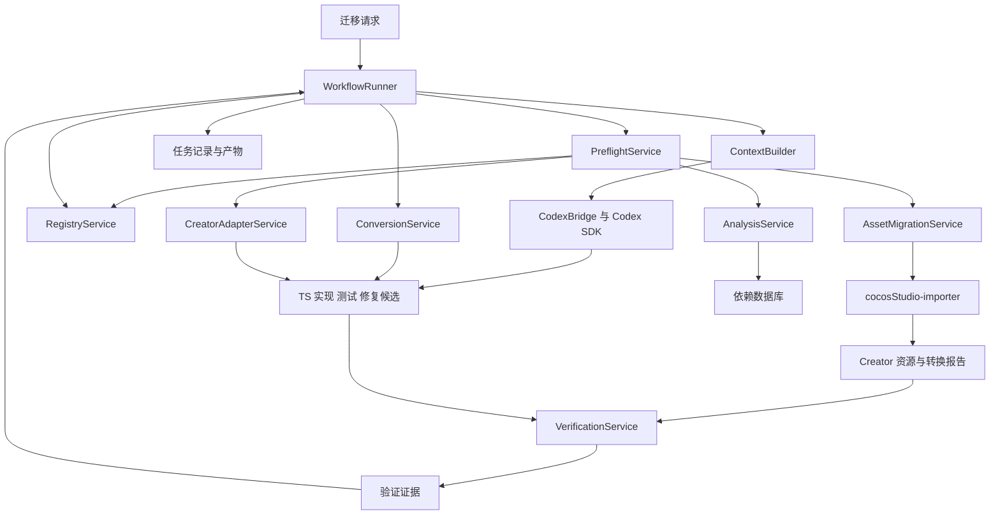

# cocos2d-x 3.10 Lua 项目迁移到 Cocos Creator 3.8 的 Codex SDK Agent 架构设计

状态：设计草案。版本：v0.5。日期：2026 年 10 月 21 日。

本 Agent 的职责是：将 cocos2d-x 3.10 Lua 项目逐步迁移到 Cocos Creator 3.8，交付在目标平台中可运行、可验证、可继续维护的工程与功能模块。当前源项目为 S-Project，目标代码采用 TypeScript。

迁移覆盖业务代码、Lua 行为、引擎 API、场景与 UI、资源引用、组件生命周期，以及相关原生扩展能力的替代或接入。现有 `lua2ts-offline` 是其中的源码分析与转换工具；Codex SDK 承载理解、生成和修复任务，工作流执行器组织工程迁移与验收。首批迁移单元为 `ccp`、`ccsize` 和 `ViewManager`。

UI 资源转换采用用户已有的 [cocosStudio-importer](https://github.com/youngl0/cocosStudio-importer/releases)。Agent 调度该工具并消费转换报告，负责后续脚本、节点、事件和生命周期接入；不再将自建 CSD 转换核心作为初版任务。

全局变量与全局函数统一建模为全局符号。分析数据库记录源码事实；迁移注册表记录目标实现及验证状态；任务记录保存执行进度；TS 适配模块提供真实实现。Agent 根据这些数据理解代码和生成修改，工作流执行器根据检查证据推进状态。

本文定义初版架构与验收标准，不包含实现代码。文中的新模块、字段和操作均为规划能力；现有能力在下表中单独说明。

针对固定版本的 API 映射、生命周期、CSD / Prefab 与资源适配，以及 `ccp`、`ccsize`、`ViewManager` 的具体迁移决策，见 [Creator 3.8 适配设计](creator-3.8-adaptation-design.md)。其中明确首版保留几何数据契约、在引擎边界转换目标值类型，并按功能拆分 ViewManager 的验收范围。

## 目标与现有能力

### 职责与完成标准

| 职责 | 交付内容 |
| --- | --- |
| 理解源项目 | Lua 符号与函数统计、文件依赖、启动顺序、业务边界及所需资源清单 |
| 规划迁移 | 根据目标 Creator 版本形成迁移单元、依赖顺序、行为契约和缺口报告 |
| 迁移代码与运行行为 | TS 业务模块、Lua 语义适配、引擎 API 映射和经过验证的导入 |
| 接入 Creator 工程 | 服务与组件的职责划分、场景和 Prefab 接入、事件及生命周期适配 |
| 迁移资源与 UI | 资源依赖映射、UI 重建或转换、节点绑定、资源导入与引用检查 |
| 验证并维护迁移状态 | 静态检查、契约测试、Creator 导入及构建检查、运行场景证据和可恢复的任务记录 |

完成标准按迁移单元定义。纯函数需要契约与目标调用验证；业务功能需要其代码、资源和引擎依赖就绪，并通过指定 Creator 运行场景。仅生成 `.ts` 文件、通过语法检查或完成 checklist 登记，均不足以判定功能迁移完成。

原项目中的 `pc.*`、自定义 C++ 绑定和第三方原生 SDK 也属于依赖调查范围。Agent 为被迁移功能确定其 Creator 替代、平台实现或阻塞项；初版不承担整个 cocos2d-x 引擎及全部 C++ 代码的逐行移植。

### 初版目标

初版采用一个 Codex Agent、一个顺序执行的工作流执行器，完成以下闭环：

1. 查询待迁移文件的符号和加载依赖，核实数据库与源码的一致性。
2. 查明全局符号来源，形成可检查的行为契约。
3. 根据 Creator 目标配置编写 TS 适配实现与测试，登记通过验证的导出映射。
4. 转换文件，依据名称绑定生成 import，识别 Creator API、资源及生命周期的剩余迁移缺口。
5. 为首批功能接入所需的 Creator 工程结构与验证入口。
6. 根据实际检查结果修复或记录阻塞，支持中断后恢复。

首轮允许交付部分迁移的预览文件。整个文件只有满足目标工程的验证标准后，才能标记为迁移完成。

### 现有工具基线

| 能力 | 当前状态 | 初版复用方式 |
| --- | --- | --- |
| 目录分析与增量更新 | 已实现 | 复用 `analyzeDirectory` 与内容哈希缓存 |
| 分析进度 | 已实现 | 复用阶段事件和终端显示 |
| 分析解析兼容 | 已实现 | 优先 Lua 5.1，失败后尝试 LuaJIT、Lua 5.2，记录 `parseMode` |
| 全局访问记录 | 已实现 | 有读、写和成员修改记录；全局函数定义已记录为写入，但缺少函数类型与调用分类 |
| 依赖查询 | 已实现 | 复用 `DependencyQuery`，支持直接及间接候选依赖 |
| Lua 到 TS 转换 | 已实现 | 复用 `syntax`、`compatible` 两种模式 |
| 转换检查 | 已实现部分 | 当前以生成代码的 TS 语法诊断为主 |
| 统一符号身份与函数统计 | 待实现 | 扩充分析模型、作用域绑定及派生索引 |
| 迁移注册表与依赖预检查 | 待实现 | 新增项目级迁移状态及映射 |
| 自动导入 | 待实现 | 根据 AST 绑定及已验证映射生成 |
| UI 资源转换 | 已有独立工具；尚未集成 | 通过 cocosStudio-importer 转换，接入其报告与产物 |
| Creator API、生命周期与资源编排 | 待实现 | 新增目标版本配置、引擎映射及 importer 适配器 |
| 目标工程验证与任务恢复 | 待实现 | 新增验证器、执行器和 SDK 接入 |

目录分析的兼容解析能力不代表转换器已经支持这些方言。转换器当前仍使用 Lua 5.1 语法；预检查需要分别判断“能够分析”和“能够转换”。

### 初版边界

初版聚焦本地工程、单任务顺序执行、共享适配模块，以及首批文件和相关功能的迁移。工程迁移是总体职责，但首轮不要求自动迁移全部游戏、全部 UI 资源或全部平台能力。任意动态 Lua 的完全求值、跨界面的批量业务接入与验收、多 Agent 并发调度留待后续扩展；importer 已有的批量资源转换能力可以直接复用。

迁移基线已确定为 cocos2d-x 3.10 → Cocos Creator 3.8，目标 API、组件、资源格式和构建约定均按 Creator 3.8 设计。实际执行时记录所用 3.8.x 补丁版本，以保证验证可复现；目标工程位置和首批运行平台尚待配置。

## 总体架构与模块



### 模块职责

| 模块 | 输入 | 输出 | 职责 |
| --- | --- | --- | --- |
| `AnalysisService` | 源码根目录、分析配置、数据库 | 分析快照、依赖查询 | 包装现有分析器和查询器；核对内容哈希；维护统一符号索引 |
| `PreflightService` | 目标文件、分析快照、注册表、目标配置 | `ConversionPlan` | 区分实际使用、缓存别名和写操作；检查缺口、歧义及转换支持情况 |
| `RegistryService` | 符号身份、契约、TS 导出、验证证据 | 注册表条目、有效性判断 | 维护唯一迁移映射；检查导出和验证指纹；保存来源决策 |
| `ConversionService` | 原 Lua、转换计划、转换模式 | 原始生成结果、带导入的候选文件、诊断 | 调用现有转换器，按绑定生成名称和 import，保存产物对应关系 |
| `CreatorAdapterService` | 源引擎调用、行为契约、Creator 版本配置 | API 映射、适配方案、生命周期及平台缺口 | 区分直接映射、适配包装、结构重构和不支持能力；组织服务、组件与引擎边界 |
| `AssetMigrationService` | 源 CCS、所选 CSD、目标目录、业务资源引用 | 资源迁移记录、importer 报告、绑定与缺失报告 | 调度 cocosStudio-importer；登记实际输出和 UUID；关联业务绑定；不实现第二套 UI 转换核心 |
| `VerificationService` | 代码与资源候选、契约、目标配置 | `VerificationResult` | 执行语法、模块、类型、行为、Creator 资源导入、构建及运行场景检查；提供可追溯结果 |
| `ContextBuilder` | 当前步骤、符号或文件、诊断 | 当前任务的上下文包 | 提取定义、引用、契约和有效实现；限制上下文范围 |
| `CodexBridge` | 上下文包、任务要求、已有 SDK 任务标识 | 候选修改、结果说明、SDK 任务标识 | 隔离 SDK 调用，支持连续执行和任务恢复 |
| `WorkflowRunner` | 用户请求、项目配置、已有任务 | 步骤调度、状态、产物清单 | 决定迁移顺序，执行检查、管理修复次数和恢复，提交有效状态更新 |

作用域绑定分析属于 `PreflightService` 与转换器共同使用的基础能力，应有统一的 `BindingResolver`。它为局部声明、参数、循环变量和引用分配绑定身份，防止预检查与导入生成各自理解名称。

### Agent 与执行器的分工

Agent 负责读取相关源码与资源定义、解释行为、提出来源和引擎映射判定、编写 TS 实现及测试、生成资源转换或重建方案，并根据诊断修复。它的完成说明是候选结论。

执行器负责调用分析与转换接口、执行命令、计算哈希、核对实际产物、保存验证结果和更新状态。只有执行器可以根据验证证据将注册表提升为 `verified`，或将文件任务提升为 `completed`。

Codex SDK 支持通过 TypeScript 启动、继续和恢复本地 Codex 任务。初版使用这些任务能力承载单个迁移单元的上下文；应用自己的任务状态独立持久化。参见 [Codex SDK 官方文档](https://learn.chatgpt.com/docs/codex-sdk)。

### 操作接口与 SDK 任务粒度

以下为执行器的逻辑操作接口。现有库函数优先在进程内复用；规划操作在实现后也应提供结构化输入输出。

| 操作 | 核心输入 | 核心输出 | 对应能力 |
| --- | --- | --- | --- |
| 分析与更新 | 源码目录、分析配置、已有数据库 | 快照、变化统计、诊断 | 已有 `analyzeDirectory` |
| 查询依赖 | 快照、文件、是否递归 | 符号、文件、加载项和诊断 | 已有 `DependencyQuery.getFileDependencies`，后续扩充符号字段 |
| 预检查 | 文件、快照、目标配置、注册表 | `ConversionPlan` | 规划 |
| 规划引擎适配 | API 使用、生命周期、Creator 版本及平台 | 适配决策与能力缺口 | 规划 |
| 迁移资源与绑定 | 资源清单、源 UI 定义、目标工程及已有资源记录 | 资源候选、引用映射和导入报告 | 规划 |
| 构建上下文 | 当前迁移单元和相关证据 | `ContextPackage` | 规划 |
| 生成或修复 | 上下文包、已有候选与失败结果 | `AgentResult`、候选文件 | 规划中的 SDK 接入 |
| 转换候选 | 原 Lua、转换模式、导入计划 | 代码、诊断与产物映射 | 已有 `convertLua`，规划接入转换计划 |
| 执行验证 | 迁移单元、候选、契约和策略 | `VerificationResult` | 规划 |
| 发布迁移状态 | 当前指纹、产物和验证证据 | 新注册表版本或阻塞结果 | 规划 |

`ccp`、`ccsize`、`ViewManager` 分别保存自己的 SDK 任务标识，并顺序执行；这是同一个 Agent 承担不同迁移单元，而非并发多 Agent。一个单元的修复轮次继续同一 SDK 任务。任务无法恢复时，根据持久化步骤和上下文包创建新任务，不丢失已验证产物。

SDK 执行环境应将原 Lua 和源资源目录配置为只读，将代码、资源候选与测试的写入范围限定在迁移工作区和目标工程。每轮结果通过应用自己的数据契约校验；这里的逻辑操作名不表示 SDK 已提供同名内置工具。

## 数据归属与工作区

### 四类数据的关系

| 数据 | 回答的问题 | 更新主体 | 生命周期 |
| --- | --- | --- | --- |
| 分析数据库 | 原 Lua 中观察到了什么 | 分析器 | 随源码与分析规则更新 |
| 迁移注册表 | 此符号或资源在 Creator 中对应什么，是否经过验证 | 注册表服务与验证器 | 随迁移决策、实现和验证更新 |
| 任务记录 | 本次迁移执行到了哪里 | 工作流执行器 | 一次执行及其恢复过程 |
| Creator 工程产物与测试 | 迁移后的代码、资源和运行行为是什么 | Agent 或开发者生成，验证器检查 | 跟随目标工程版本管理 |

全局变量和全局函数共用分析数据库与迁移注册表。函数签名、调用信息等属于统一符号的附加信息。

数据库中的 `annotations` 继续保存分析备注。迁移状态以注册表为唯一权威来源，任务执行状态以任务记录为唯一权威来源。

### 规划工作区

```text
migration-project/
  migration.project.json
  migration-registry.json
  asset-migration-registry.json
  contracts/
  state/
    lua-analysis.json
  staging/
    generated/
    assets/
  target-creator/
    assets/
      scripts/
        adapters/
        game/
      scenes/
      prefabs/
      resources/
    ...目标版本的工程配置及资源元数据
  tests/
  runs/
    <run-id>/
      run.json
      events.jsonl
      context/
      plans/
      verification/
      artifacts.json
```

这是迁移工程的规划布局，具体资源目录和加载策略由 Creator 目标配置决定。现有 CLI 默认仍在输入文件或目录旁输出；Agent 工作流通过显式输出路径把原始候选写入 staging，再将可检查的产物接入 Creator 工程，避免半成品被编辑器直接导入。

原始生成结果与最终候选代码分开保存。重新转换时先生成新版本，再与已有候选修改比较；发现双方同时修改的冲突时保留冲突记录，避免覆盖人工或 Agent 已完成的有效修改。

## 统一全局符号模型

### 符号身份

统一使用 `SymbolRecord` 表示顶层全局及从全局对象可定位的成员。身份由以下字段组成：

| 字段 | 含义 |
| --- | --- |
| `projectId` | 源项目身份 |
| `runtimeScope` | 客户端、服务端或尚未判定的运行环境 |
| `rootName` | 顶层全局名称，例如 `cc` 或 `ccp` |
| `memberPath` | 成员路径数组，例如 `cc.p` 的路径为一个成员 `p` |
| `storageKind` | `global` 或 `member` |
| `symbolId` | 上述结构字段形成的稳定身份 |
| `displayName` | 用于展示的名称，例如 `cc.p` |

名称保持大小写敏感。成员路径使用结构化数组，避免把 `_G["a.b"]` 和全局对象 `a` 的成员 `b` 混为同一符号。

`runtimeScope` 必须来自配置或有依据的运行环境判定。仅因文件位于某个目录就排除全部候选定义，会造成遗漏；未能确定的候选继续保留并交给预检查处理。

### 全局变量与函数的统一识别

| Lua 形式 | 统一记录方式 |
| --- | --- |
| `Value = 1` | 对顶层全局 `Value` 的赋值，值类型为数字 |
| `function Foo() end` | 对全局 `Foo` 的函数赋值 |
| `Foo = function() end` | 与上项共用符号身份，保留对应定义位置 |
| `_G.Foo = function() end` | 归并到顶层全局 `Foo` |
| `rawset(_G, "Foo", fn)` | 对 `Foo` 的赋值；能追踪到 `fn` 时补充类型证据 |
| `Foo()` | 对 `Foo` 的读取，并标记为调用 |
| `local function Foo() end` | 局部绑定；不计入全局符号 |
| `function cc.p() end` | 全局对象 `cc` 的成员函数 `cc.p` |
| `function Global:method() end` | 成员函数，记录冒号声明和隐式 `self` |
| `local T = {}; function T:method() end` | 局部对象成员；没有全局暴露证据时不计入全局符号 |
| `_G[key]` | 无法解析键时记录动态访问及原表达式，不臆造具体符号 |

局部函数之后被赋给全局时，需要记录全局暴露的位置及函数来源。函数作为参数传递或被局部别名缓存时，保留绑定关系；超出初版追踪能力的路径标记未知。

### 符号记录字段

| 字段 | 含义 |
| --- | --- |
| `definitions` | 定义和赋值位置、赋入值的种类、所在作用域及上下文 |
| `references` | 读取、调用和修改等源码访问位置 |
| `possibleKinds` | `function`、`table`、`number`、`string`、`boolean`、`nil`、`userdata`、`unknown` 的可能集合 |
| `classification` | 从证据派生的 `function`、`value`、`mixed`、`unknown` 分类 |
| `signatures` | 已知参数、是否可变参数、冒号接收者及签名来源 |
| `originEvidence` | 全局映射、别名、导出或已确认来源关系 |
| `availability` | 是否发现定义，或属于内置、外部、未解析范围 |

`definitions` 中保留函数内、条件分支中的赋值事实，不据此推断它们必然执行。一个符号既可能赋函数又可能赋数字时归类为 `mixed`，各处定义都保留。

仅看到调用不能证明某个值已经确定为函数；仅看到返回语句也不必然能确定完整返回类型。未知类型与推断证据应分开表达。

`references` 中的调用仍是一种读取，使用访问种类表达，避免把同一个源码位置在读取和调用中重复累计到总访问数。局部别名调用可以关联到原全局，但保持其实际源码位置和绑定身份。

### 统计口径

统计按符号身份去重；定义次数、引用次数、调用次数按源码访问记录分别统计。

| 指标 | 口径 |
| --- | --- |
| 顶层全局符号总数 | `storageKind = global` 的去重符号数 |
| 顶层全局函数数 | 顶层符号中 `classification = function` 的数量 |
| 顶层全局值数量 | 顶层符号中 `classification = value` 的数量 |
| 混合类型与未知类型数 | 各自独立分类，与上述分类不重复 |
| 全局对象成员数 | `storageKind = member` 的去重符号数，单独展示 |
| 成员函数数 | 全局对象成员中确认属于函数的数量 |
| 调用次数 | 直接或有绑定证据的调用位置数量；未解析调用另计 |

例如 `cc` 是一个顶层全局，`cc.p` 是一个成员函数，`ccp` 是另一个顶层全局函数。来源关系连接这些记录，但不把它们的源码身份合并。报告可以另行按实现来源归组。

### 依赖图与来源判定

显式加载、符号读取、函数调用和成员修改统一进入依赖模型，同时保留原因、位置和确定程度。

全局对象成员定义应有独立索引。例如一个文件定义 `Global.foo`，另一个文件调用它，预检查应能发现成员提供者。成员定义仍然可能依赖全局对象 `Global` 的初始化，因此根对象与成员来源都需要保留。

当前依据顶层全局赋值产生的文件依赖属于候选关系。统一模型补充函数和成员信息后，依赖判定可以更精确，但同名赋值、分支执行和动态加载仍可能产生歧义。确认、排除或保留候选的决定放在转换计划中，并引用依据。

### 分析数据库演进

现有数据库为 `schemaVersion = 1`，当前分析器版本为 2。上述结构化符号身份、函数分类、调用和绑定索引进入规划中的分析格式 v2；这里的格式版本与分析器版本分别维护。

旧格式继续由兼容读取层支持。旧数据缺少的信息标为未知，不能推断已经统计完整。启用新版分析模型时对源码重新建索引，并保留配置与 `annotations`；缓存键包含格式、分析器和相关配置版本。

## 项目配置与持久化数据结构

以下字段是规划数据契约，不是已存在的 SDK 参数。

### MigrationProject

| 字段 | 用途 |
| --- | --- |
| `projectId`、`sourceRoot`、`sourceAssetRoots` | 源项目、源码和资源位置 |
| `sourceEngine`、`sourceEngineVersion` | cocos2d-x 及源版本；当前为 3.10 |
| `analysisDatabase` | 分析快照位置 |
| `targetRoot`、`targetProfileId` | 目标工程和行为约定 |
| `targetEngine`、`creatorVersion`、`targetPlatforms` | 固定为 Cocos Creator 3.8；执行时记录实际 3.8.x 补丁版本及验收平台 |
| `creatorProfile` | 工程模板、引擎 API、组件与生命周期、资源导入和构建约定 |
| `uiImporter` | cocosStudio-importer 版本、工具路径、源 CCS、选择项、目标资源目录与执行入口 |
| `runtimeScope` | 本次迁移的运行范围 |
| `conversionMode` | `syntax` 或 `compatible` |
| `registryPath` | 迁移注册表位置 |
| `assetRegistryPath`、`assetPolicy` | 资源映射记录及复用、转换、重建和加载策略 |
| `verificationPolicy` | 各类迁移单元的必要检查和通过标准 |
| `toolCommands` | Lua 参考运行、类型检查、测试、Creator 导入、构建和运行验证入口 |
| `limits` | 修复次数、任务时间或成本限制 |

目标配置需要明确 Creator 工程的模块解析与 TS 配置、Lua nil 的表示、数据对象与引擎对象的转换边界，以及 `pc.*` 等外部 API 的适配约定。Creator 版本和平台进入验证指纹；切换配置时重新判断相关映射及集成证据的有效性。

### MigrationRegistryEntry

| 字段 | 用途 |
| --- | --- |
| `entryId`、`symbolId`、`targetProfileId` | 一个符号在特定目标配置中的迁移身份 |
| `sourceEvidence` | 定义、引用、启动映射和相关文件哈希 |
| `contractRef`、`contractHash` | 行为契约及其版本 |
| `targetModule`、`exportName`、`exportKind` | TS 模块、导出及导出类型 |
| `bindingSemantics` | 函数快照、不可变值、可变状态或其他适配约定 |
| `adaptationKind`、`creatorApi` | 直接映射、包装适配、结构重构或不支持，以及使用的目标 API 与版本约束 |
| `dependencies` | 所需的其他迁移条目 |
| `status` | `pending`、`implemented` 或 `verified` |
| `verificationRefs` | 支撑当前状态的验证记录 |
| `notes` | 有关来源或迁移决策的说明 |

`verified` 表示满足该符号类别和目标配置要求的检查，不代表它所依赖的整个业务文件均已完成迁移。读取注册表时派生 `effectiveStatus`，当指纹不匹配时显示为 `stale`，不继续用于正式完成判定。

初版可使用相关来源文件哈希保守地使验证失效。后续可以细化为函数和映射片段指纹，减少无关修改导致的重复验证。

### AssetMigrationRecord

资源记录与符号 checklist 共同构成迁移登记体系，但使用独立身份和索引。符号身份不能充当资源 UUID。源 Lua 分析数据库继续保存源码事实；资源扫描与迁移服务补充资源及绑定图。

| 字段 | 用途 |
| --- | --- |
| `assetId`、`sourcePath`、`sourceKind`、`sourceHash` | 稳定来源身份、路径、格式和内容版本 |
| `sourceDependencies`、`codeReferences`、`nodeBindings` | 依赖资源、加载位置和 Lua 节点绑定 |
| `targetProfileId`、`strategy` | 目标配置及复用、转换、重建或暂不支持的决策 |
| `targetPaths`、`targetUuids`、`metadataRefs` | Creator 输出资源、导入后的 UUID 与元数据；允许一对多映射 |
| `converter`、`conversionReportRef`、`selection` | importer 的实际版本、原始报告及本次选择；保留可追溯输入输出 |
| `bindingMap` | 源节点或属性到目标节点、组件及属性的映射 |
| `status`、`verificationRefs`、`blockers` | 迁移状态、导入和运行证据及未解决问题 |

UI 默认调用 cocosStudio-importer，登记其实际输出及复用结果。完全相同资源的复用与源内容变化后的更新分别处理：若工具另存新 Prefab 或资源，Agent 保存候选版本并重新核对业务引用，不能假定旧 UUID 已被原位更新。Creator 资源身份说明见 [资源元数据文档](https://docs.cocos.com/creator/3.8/manual/en/asset/meta.html)；工具接入细节见 [适配设计](creator-3.8-adaptation-design.md)。

### ConversionPlan

| 字段 | 用途 |
| --- | --- |
| `inputSnapshot` | 输入文件哈希、分析快照、注册表与工具版本 |
| `globalDependencies`、`memberDependencies` | 文件真正涉及的全局与成员依赖 |
| `bindings` | 声明、参数、局部缓存与各引用的绑定身份 |
| `aliasDecisions` | 保留、重命名或省略缓存别名的决定及依据 |
| `resolvedMappings` | 可以使用的已验证迁移条目 |
| `pendingDependencies` | 尚未迁移的符号、外部 API 或模块 |
| `engineAdaptations`、`lifecyclePlan` | Creator API 映射、服务与组件划分、初始化及销毁约定 |
| `assetDependencies`、`assetPlanRefs` | 当前功能所需的资源、UI 与节点绑定迁移计划 |
| `importPlan` | 导入模块、导出、本地名称和消费绑定 |
| `dependencyDecisions` | 候选提供者的确认、排除或保留决定 |
| `conflicts`、`blockers` | 写入冲突、歧义和不能继续正式迁移的条件 |
| `conversionSupport` | 当前模式能否转换源码，以及需要的工具运行时支持 |
| `readiness` | 可正式推进、仅可生成预览或被阻塞 |

如果无法可靠理解作用域或将名称绑定到迁移条目，就不应生成猜测性的 import。依赖不足但绑定明确时，可以生成带完整缺口报告的预览。

### VerificationResult

| 字段 | 用途 |
| --- | --- |
| `verificationId`、`unitId` | 验证及被验证单元 |
| `inputFingerprint` | 来源、契约、实现、测试、配置和工具版本的组合指纹 |
| `checks` | 各检查的要求、命令、工作目录、退出码和结果 |
| `evidence` | 日志、差分结果、产物位置及其哈希 |
| `coverageScope` | 具体覆盖了哪些函数、方法或运行场景 |
| `oracleKind` | 真实 Lua 对比、契约预期或目标运行结果 |
| `outcome` | `passed`、`failed` 或 `blocked` |

类型声明或测试替身可以支撑隔离测试，但要记录其覆盖范围。通过替身测试不能替代真实目标环境的集成检查。

### MigrationRun 与 StepRecord

| 字段 | 用途 |
| --- | --- |
| `runId`、`request` | 本次请求和指定范围 |
| `inputSnapshot` | 执行开始时的输入版本 |
| `units`、`plan` | 迁移单元及先后关系 |
| `steps` | 各步骤的状态、次数、时间、错误和阻塞项 |
| `codexThreads` | 迁移单元对应的 SDK 任务标识 |
| `artifacts` | 原始生成文件、候选文件、测试、报告及哈希 |
| `verificationRefs` | 本次实际采用的验证证据 |
| `events` | 执行事件记录位置 |
| `outcome` | 完成、部分产出、失败、阻塞或取消 |

每个步骤保存输入指纹和已发布产物。恢复时检查有效性，复用有效步骤，对输入变化的步骤及其下游重新执行。

### ContextPackage 与 AgentResult

上下文包包括当前任务、Creator 版本与平台、相关源码片段及位置、资源和绑定摘要、契约、已验证映射、候选定义歧义和待修复诊断。使用分析与查询接口选取上下文，不把完整数据库或全部间接文件交给模型。

Agent 结果包括生成或修改的文件、结果说明、提出的来源决策和未解决问题。执行器校验其结构、读取真实产物并运行检查。结果中的“通过”或“完成”文字不能直接更新注册表。

## 执行状态与恢复规则

### 状态流转

注册表的持久化状态为 `pending → implemented → verified`。验证失败保留实现和失败证据，验证是否过期通过指纹派生判断。

文件任务的阶段为 `planned → preflighted → generated → validating → completed`。缺少必要依赖时可以停留在预览产出阶段，并记录阻塞项。

单个执行步骤使用 `pending`、`running`、`validating`、`succeeded`、`failed`、`blocked`、`cancelled`。异常退出、主动取消和缺少目标环境分别记录，不合并为成功。

### 执行与恢复约束

1. 同一注册表采用单写入者，验证证据和状态更新有明确先后顺序。
2. 更新注册表、任务记录和分析快照时使用临时产物及原子替换。
3. 任务恢复以输入指纹为依据；SDK 会话记录用于继续上下文。
4. 发布验证结果前再次核对关键输入，避免对已经变化的文件使用旧证据。
5. 修复达到限制时保存产物和具体诊断，后续请求可以继续处理。
6. 源码、实现、契约、导出、依赖版本或目标配置变化时，使相关验证及下游完成状态失效。

初版不要求独立的网络服务。执行器在进程内复用现有 TypeScript 查询接口和内存索引，避免每次查询都重新读取大 JSON；已有 CLI 继续作为手动使用和自动化命令入口。

## 自动导入与转换策略

### 导入条件

一个符号参与自动导入，需要同时满足：目标文件确实使用它、来源绑定清楚、注册表条目对当前配置有效、TS 模块和导出存在，并且导出类型与使用方式相符。

全局函数与普通全局值走相同流程。对可变全局或被重新赋值的函数，还需要可变状态、访问器或依赖注入等明确适配策略；不能统一替换成只读 import。

`compatible` 模式使用的 `luaTruthy` 等工具运行时辅助函数由工具运行时映射管理。原项目全局符号由迁移注册表管理。Lua 内置能力是否已覆盖，按转换模式和目标配置判断，不能仅因名称是内置就视为已经迁移。

### 局部缓存与名称冲突

`local ccp = ccp` 的左侧是局部声明，右侧是全局读取。导入使用独立且无冲突的名称，再初始化对应局部绑定，保留原有缓存语义和可能发生的局部赋值。

同名函数参数、循环变量或嵌套局部声明拥有不同绑定身份。替换范围按绑定决定，不能进行全文名称替换。

只有确认别名无后续读写，且省略该全局读取没有副作用时，才删除无用缓存。对潜在全局元表读取等情况保留代码或提出明确诊断。

同一模块的 import 合并，路径按目标输出位置和模块解析配置计算。生成结果保留映射到原 Lua 位置的诊断依据，方便修复时回溯。

### 规则转换与 Agent 修复

预检查形成计划后，转换器生成候选代码与导入。通用语法或语义生成错误修复到转换规则中；目标工程特有适配修复在适配模块中；业务行为重构保存为候选代码变更并附验证依据。

`syntax` 模式适合首轮人工和 Agent 阅读预览，但不能单凭生成结果判定行为等价。正式迁移时为真值、table 索引、多返回值、迭代器、类和方法调用等行为选择经验证的规则或适配。

### Creator 工程适配

迁移计划需要分别处理业务服务、引擎节点和组件。管理器可以保留为普通 TS 服务，通过明确入口接入 Creator；原 Lua 的 View 类则按其实际职责拆分业务逻辑和组件。不能把所有 Lua 类统一改成 Component，也不能把 `ctor` 机械替换为 `onLoad`。

引擎适配需要检查初始化和销毁时机、事件取消、定时任务、动作、坐标与锚点、层级、异步资源加载以及资源释放。具体 API 和执行顺序以选定版本及行为契约为准。Creator 的 Component 由引擎创建，构造约束和生命周期需要专门处理，参见 [Creator Component 文档](https://docs.cocos.com/creator/3.8/api/en/class/Component)。

原 Lua 与 Creator 的同名 API 不能仅凭名称判定等价。`cc.*`、`ccui.*`、`pc.*` 的每类使用都要选择直接映射、适配模块、业务重构或阻塞；缺少实现的 API 不用空函数替代后登记为完成。

## 首批迁移流程

`ccp → ccsize → ViewManager` 表示实施顺序。`ccp` 与 `ccsize` 是独立适配项；`ViewManager` 的迁移并不只依赖这两个函数。

### 建立来源证据和输入快照

项目实际源码提供了以下依据：

| 符号 | 来源 | 当前行为要点 |
| --- | --- | --- |
| `ccp` | `main.lua` 把 `cc` 成员复制到前缀全局；实现位于 `Cocos2d.lua` 的 `cc.p` | 双参数创建点；第二参数为 nil 时读取点对象字段并创建新对象 |
| `ccsize` | 同一启动映射；实现位于 `Cocos2d.lua` 的 `cc.size` | 根据宽高创建新尺寸结构 |
| `ViewManager` | 控制器 Lua 文件及分析数据库 | 首行包含多个全局缓存；其中 `ccsize` 当前只在缓存声明中出现 |

启动代码完成复制后还会清空 `cc.p`、`cc.size` 等字段。因此注册表应表达“启动时捕获函数实现”的来源，不能把迁移后的调用简单重定向到之后已被清空的 `cc.p`。

执行器记录原 Lua 文件哈希、分析快照、注册表版本和目标配置。原 Lua 源文件保持不变；参考执行或函数提取使用临时测试环境。

### 迁移 ccp

1. `AnalysisService` 收集全局 `ccp` 的引用以及 `cc.p` 的定义位置。
2. Agent 阅读启动映射、函数定义和代表性调用，形成来源和行为契约。
3. 契约明确双参数构造、单点参数拷贝、新对象身份、字段缺失和异常输入的处理；不自行增加零值默认参数。
4. 根据 Creator 版本确定点对象适配边界，生成共享 TS 实现与测试，状态进入 `implemented`。源 table 的契约与目标引擎点类型需要分别核对，不能直接假定构造器默认值、字段和异常行为一致。
5. 验证器检查导出和类型，并在配置的 Lua 参考环境中对纯函数进行差分测试。
6. 覆盖双参数、点对象拷贝、零值、负数、缺失字段、无参数及修改隔离等契约分支。
7. 验证目标 Creator 中实际消费该点对象的接口；通过当前配置要求的检查后，执行器保存证据，将条目提升为 `verified`。

参考执行应保留 Lua table 中 nil 字段缺失的含义，区分值、缺失字段和新对象身份。没有可用 Lua 参考运行环境时记录验证阻塞；基于源码写出的预期测试不能冒充已经执行的 Lua 差分验证。

### 迁移 ccsize

1. 读取 `cc.size` 的实际定义和调用范围，建立独立契约。
2. 明确宽高字段、新对象身份、零值、负值和缺失参数行为。
3. 按源码处理 nil 字段，避免自行增加单尺寸对象重载或默认宽高。
4. TS 实现可以与 `ccp` 放在 Creator 工程的同一几何适配模块中，但条目、契约和验证证据分别维护。
5. 检查源尺寸结构与 Creator 消费接口的边界，执行导出、类型、行为及必要的引擎调用验证，通过后登记为 `verified`。

### 预检查 ViewManager

预检查先查询直接依赖，再按当前迁移单元需要扩展。客户端、服务端同名定义及全局重新赋值造成的候选关系保留来源，不把全部间接候选自动加入迁移队列。

将文件涉及的内容分为四组：

| 分组 | 处理 |
| --- | --- |
| 已验证且实际使用 | 如 `ccp`，生成导入计划 |
| 仅缓存且确认无后续使用 | 当前 `ccsize`，在证明省略安全后不生成无用导入 |
| 未迁移但绑定明确 | 记录缺口，允许生成预览 |
| 绑定或语义存在冲突 | 对相关转换提出阻塞，保留位置和原因 |

全局函数、普通值、类和成员调用使用同一符号与注册表流程，按种类选择适配方式。预检查同时列出 Cocos API、其他项目管理器、Lua 内置行为和工具运行时支持的剩余需求。

在此基础上，检查 `ViewManager` 实际使用的视图创建、层级管理、资源加载、事件和销毁行为，形成 Creator 接入计划。涉及 UI 时补充相应 Prefab 或场景、节点绑定及资源依赖；此类需求由源码使用证据决定，不假定该文件独自包含完整视图实现。

### 生成 ViewManager 候选

1. 固定输入快照并生成 `ConversionPlan`。
2. 复用现有转换器，以 `syntax` 模式生成首轮可读候选。
3. 依据绑定与注册表为实际使用的已验证符号生成 import。
4. 保留 `ccp` 等局部缓存语义，处理同名遮蔽和名称冲突。
5. 将业务管理职责组织为 TS 服务，按需要增加 Creator 组件或启动入口；接入本轮必需的资源与节点绑定。
6. 保存转换诊断、引擎与资源迁移缺口和产物哈希。
7. 将状态记为 `generated`，而非整个文件迁移完成。

如果开发目标选择 `compatible` 模式，仍采用同一预检查和注册表；工具兼容运行时随产物参与模块和行为验证。

### 验证和继续迁移 ViewManager

| 验证层 | 检查范围 | 能够支持的结论 |
| --- | --- | --- |
| TS 语法 | 生成文件可解析 | 语法成立 |
| 模块与类型 | import、导出、类型和目标 TS 配置 | 工程中的静态连接成立 |
| 适配函数行为 | `ccp`、`ccsize` 等契约 | 指定符号满足已记录契约 |
| 方法级行为 | 指定方法、参数、返回和交互 | 已覆盖方法符合预期 |
| Creator 工程检查 | 编辑器导入、资源引用、组件绑定和指定平台构建 | 代码与资源能接入指定版本工程 |
| Creator 运行集成 | 实际管理器、生命周期及选定的视图打开、关闭、层级和清理场景 | 已覆盖场景在 Creator 中可运行，并满足记录的行为契约 |

验证失败时，Agent 获得相关代码、诊断和契约，修复后由执行器重新运行受影响检查。缺少必要 Cocos 能力或目标运行环境时，保存明确阻塞项。

首轮可交付两个经过验证的 Creator 符号适配条目、一份带已知导入及 Creator 接入方案的 `ViewManager` 候选，以及剩余代码、引擎和资源缺口报告。如果必要依赖尚未就绪，这属于部分迁移产出。只有对应功能的代码、资源与绑定全部就绪，且目标配置要求的 Creator 检查通过，任务才能进入 `completed`。

## 实施顺序与验收

### 建议实施顺序

1. 按 cocos2d-x 3.10 → Creator 3.8 基线配置目标工程及首批平台；记录实际补丁版本；确定统一符号身份和统计口径，扩充分析与查询模型。
2. 实现迁移注册表、契约和验证记录，完成 `ccp`、`ccsize` 的手动可执行闭环。
3. 接入作用域绑定、预检查和导入计划，使现有转换器消费计划。
4. 实现任务记录、步骤恢复及失效传播。
5. 接入 Codex SDK，复用前述确定的操作和验证标准。
6. 运行 `ViewManager` 迁移演练，接入相关引擎与资源服务，补齐首批运行场景并记录剩余阻塞。

### 初版验收标准

| 范围 | 验收要求 |
| --- | --- |
| 符号统计 | 全局函数与变量共用身份和索引；全局、成员及混合类型不重复统计 |
| 作用域 | 局部函数、参数、循环变量和局部对象成员不误计为独立全局 |
| 来源判定 | 可记录 `ccp` 与 `cc.p` 的启动捕获关系及对应证据 |
| 注册表 | 模块与导出真实存在；有效验证才支持 `verified`；输入变化可使验证失效 |
| 导入生成 | 正确处理缓存别名、同名遮蔽、只读导入和可变全局冲突 |
| 迁移演练 | `ccp`、`ccsize` 分别完成契约和必要检查；`ViewManager` 给出候选与完整缺口 |
| Creator 接入 | 锁定版本和平台；正式完成的功能通过资源导入、绑定、构建和约定运行场景检查 |
| 资源更新 | 资源来源和目标可追溯；增量迁移保留有效 UUID；引用缺失和不支持格式有明确报告 |
| 恢复 | 中断后可复用有效步骤；不重复覆盖有效产物；记录失败、阻塞和取消 |
| 验证 | 语法通过、类型通过、行为通过和目标集成通过有独立证据与范围 |
| 源码保护 | 原 Lua 源文件哈希保持一致 |

### 尚需确定的项目选择

源和目标版本已明确为 cocos2d-x 3.10 与 Cocos Creator 3.8。正式进入实现前，需要确定目标工程位置、首批平台、Lua nil 和结构对象约定、Lua 参考执行环境、Creator 导入与构建及运行验证入口，以及 `ViewManager` 的首批方法和 UI 场景验收范围。具体 3.8.x 补丁版本随执行环境记录。

这些选择进入项目配置与契约。它们不影响本文确定的数据归属、统一符号模型和模块边界。

## 参考资料

- [Codex SDK 官方文档](https://learn.chatgpt.com/docs/codex-sdk)：SDK 任务启动、继续与恢复。
- [现有分析器](../src/analyzer.ts)、[分析数据类型](../src/analysis-types.ts)、[依赖查询](../src/dependency-query.ts)：当前工具接口与数据基线。
- [现有转换器](../src/converter.ts)、[转换数据类型](../src/types.ts)：当前转换模式及诊断契约。
- [S-Project 启动映射](../../svn/Resources/script/main.lua)：`cc`、`ccui` 成员的全局复制与后续字段清理。
- [Cocos 点与尺寸定义](../../svn/Resources/script/cocos/cocos2d/Cocos2d.lua)：`cc.p`、`cc.size` 的原始实现。
- [ViewManager 源码](../../svn/Resources/script/game/controller/ViewManager.lua)：局部全局缓存及首批迁移对象。
