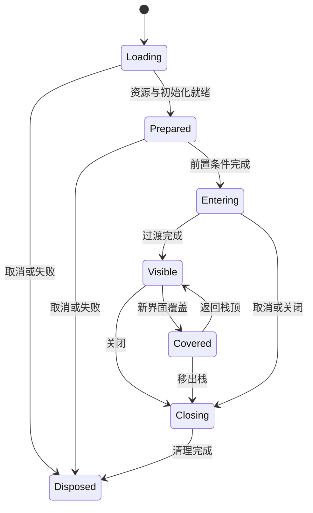

# cocos2d-x 3.10 → Cocos Creator 3.8 适配设计

状态：设计草案 v0.2。日期：2026 年 10 月 21 日。本文是 [Agent 架构设计](codex-agent-architecture.md) 的引擎、生命周期和 UI 资源细化方案。只定义迁移决策、数据和验收，不包含实现代码，也不表示已经完成 Creator 运行验证。

UI 资源转换已确定复用用户的 [cocosStudio-importer](https://github.com/youngl0/cocosStudio-importer/releases)。原先规划的自建 CSD 中间模型与 Prefab 转换核心不再是 Agent 初版实施项；本方案保留资源编排、业务绑定和运行验收。

## 迁移策略与依据

采用“保持业务契约，逐步替换引擎边界”的策略。Lua → TS 工具负责语法和可确定的 Lua 语义转换；适配层负责有明确契约的旧接口；Creator 服务、组件、Prefab 和资源系统承接目标运行行为。

初版适配层只覆盖实际依赖，不重建完整 cocos2d-x API。简单数据和调用可以包装；场景调度、UI 生命周期、资源所有权和原生能力需要按目标架构迁移。业务调用名允许阶段性保留，避免首轮同时改变导航协议和界面实现。

已核对的项目事实：

| 来源 | 对适配设计的影响 |
| --- | --- |
| [main.lua](../../svn/Resources/script/main.lua) | 启动时把 `cc`、`ccui` 成员复制为全局，随后清空部分原成员；迁移必须保留函数来源与捕获关系 |
| [Cocos2d.lua](../../svn/Resources/script/cocos/cocos2d/Cocos2d.lua) | `cc.p`、`cc.size` 返回 Lua table，不是原生引擎对象 |
| [ViewManager.lua](../../svn/Resources/script/game/controller/ViewManager.lua) | 同时承担场景入口、界面栈、弹窗、导航、输入锁、资源跟踪、应用前后台和项目定制渲染行为 |
| [BaseView.lua](../../svn/Resources/script/base/mvcs/BaseView.lua) | 按类名末段加载 `asset/ui/<Name>.csb`，绑定节点后调用 `onInit`；覆盖和返回使用 `onHide`、`onTop` 等业务钩子 |
| [BaseEvent.lua](../../svn/Resources/script/base/cocostudio/BaseEvent.lua) | `getUI` 使用完整节点名称查找；`registerUI` 可将节点赋给视图字段；触摸包装还带有项目自己的语义 |
| [LoginView.csd](../../svn/Assets/ui/cocosstudio/LoginView.csd) | CocosStudio 3.10 源 UI 存在；此样本为 1136×640，包含百分比布局、Panel、Button、九宫格和图片引用 |

1136×640 是已读样本的设计尺寸，不能直接当作全项目统一配置。后续扫描逐文件记录设计尺寸、布局与平台覆盖规则。

## 引擎 API 适配

### 按使用位置做决策

全局符号 registry 回答“导入哪个实现”；引擎映射还必须回答“这一种调用能否替换”。例如 `ccNode` 是符号，而 `setVisible`、`setPosition` 和 `removeFromParent` 的迁移规则各不相同。

为此增加规划数据 `EngineApiMapping`，作为项目迁移注册表关联的规则集，而非向分析数据库写入迁移状态。

| 字段 | 内容 |
| --- | --- |
| `mappingId`、`sourceApi`、`receiverKind` | 规则身份、源 API 和接收对象类别；无法确认接收者时保留候选 |
| `sourceSignature`、`usageEvidence` | 参数重载、返回形态、调用位置及来源实现 |
| `strategy` | 直接改写、兼容包装、结构重构或不支持 |
| `targetApi`、`adapterEntryId` | Creator API 或已登记的适配实现 |
| `argumentRules`、`returnRules` | 数据类型、单位、默认值、坐标空间、多返回值及异常规则 |
| `sideEffects`、`ownership` | 激活、回调、对象创建、资源持有和释放责任 |
| `creatorVersionRange`、`platforms` | 适用的 3.8.x 版本和平台 |
| `contractRef`、`verificationRefs` | 契约、验证证据与规则有效性 |

接收者不能仅凭方法名猜测。类型来自构造、工厂、CSD 控件、绑定关系和运行证据；动态分支不明确时，调用点报告歧义。规则依赖、源实现和目标补丁版本进入指纹。

### 首批映射矩阵

下表是拟采用的设计；并非现有工具已实现的转换规则。

| cocos2d-x / 项目接口 | Creator 3.8 承接方式 | 适配要求 |
| --- | --- | --- |
| `ccp`、`ccsize`、`ccrect` | Lua 数据契约模块；在边界转换到目标值类型 | 保持字段、拷贝与 nil 语义；不统一增加零值默认参数 |
| `ccNode:create()` | `Node`；需要 UI 几何时配置 `UITransform` | 普通节点不自动等同 UI 控件；创建策略由用途决定 |
| `ccSprite:create(...)` | `Node` + `Sprite`，绑定 `SpriteFrame` | 工厂通过资源服务加载；同步旧接口先预加载或改成异步调用链 |
| `get/setContentSize`、锚点 | `UITransform` 的尺寸与锚点 | 分别处理几何尺寸、布局驱动和图片原始尺寸 |
| 位置、缩放、旋转 | `Node` 变换；二维位置在边界补 z | 位置采用 setter；旋转方向、单位及非均匀缩放按样本校验 |
| 世界 / 本地坐标转换 | UI 坐标适配器与 `UITransform` | 区分 AR、非 AR、屏幕和 UI 世界坐标，处理父锚点 |
| `setLocalZOrder` | 层级服务排序后设置 sibling index | 保存旧逻辑 Z 值和稳定次序；不能把 50000 当作 sibling index |
| `setVisible` | 显示策略控制渲染、输入和必要的激活状态 | `active` 会影响组件生命周期，不能作为所有调用的统一替换 |
| 颜色、透明度、级联透明度 | 渲染组件颜色与 `UIOpacity` | 区分自身透明度与子树透明度；不能重复计算 alpha |
| `ccuiLayout`、`ccuiImageView`、Scale9 | UI 节点、Sprite、Widget / Layout；必要时 Mask | Layout 只用于真正的自动排版；背景、裁剪、触摸分别配置 |
| `ccuiButton`、Text、EditBox、ScrollView | 对应组件组合及事件适配器 | 检查按钮状态、标题子节点、长按、滚动事件及列表复用语义 |
| `runAction`、Sequence、Spawn、Delay、CallFunc | Tween 或 AnimationClip + 业务过渡控制器 | 维护顺序、并行、取消、完成回调和 tag；不是单纯方法改名 |
| `retain/release`、节点移除 | 显式缓存、脱离父节点或 `destroy` | 节点生命周期与 Asset 引用计数分开；JS 引用不替代引擎销毁管理 |
| 纹理与 SpriteFrame 缓存 | 资源服务、SpriteAtlas、Asset 引用与租约 | 不按旧文件名直接强制释放共享纹理 |
| `replaceScene`、全局导航与层 | 启动 Scene + UI 根节点、界面栈 | 普通界面切换使用 Prefab；仅真正场景切换才走 Scene API |
| 定时、事件、应用前后台 | 带所有者的调度和事件服务，连接 Creator 生命周期及平台事件 | 核对毫秒 / 秒、回调 this、隐藏后是否继续执行与注销时机 |
| `tolua.isnull` | Creator 对象有效性检查 + 业务 disposed 标记 | 已请求销毁的对象也不能接收新业务回调 |
| `pc.*`、定制 Director、FFI、Shader | 单独能力接口，选择目标实现或原生扩展 | 未验证能力保持阻塞；不能用空实现满足完成检查 |

Creator 3.8 将 UI 尺寸和锚点放在 `UITransform`，UI 顺序应通过节点树管理，见 [UITransform 说明](https://docs.cocos.com/creator/3.8/manual/en/ui-system/components/editor/ui-transform.html)。透明度、节点及渲染组件的拆分也可参考 [3.x 升级说明](https://docs.cocos.com/creator/3.8/manual/en/release-notes/upgrade-guide-v3.0.html)；该文是 Creator 内部升级资料，只用于确认目标接口，不能充当 cocos2d-x 项目的自动迁移规则。

### 坐标、布局和输入

`ccp` 只创建数据，不负责坐标换算。每个引擎调用点记录坐标来源和目标空间，包括旧节点内容坐标、锚点坐标、UI 世界坐标和输入位置。

对父节点内容尺寸为 W×H、锚点为 ax、ay 的常规二维分支，旧子节点位置到目标父锚点局部坐标的初始换算为减去 `(ax×W, ay×H)`。旧非 AR 内容点也要先减去本节点的锚点偏移，再进入目标 AR 转换；反向转换补回偏移。这是基于两侧变换语义的设计推导，需用真实层级验证。忽略锚点开关、容器包装、负缩放、旋转、摄像机和项目屏幕偏移必须单独处理；转换结果不能再重复补偿。

UI 静态局部坐标以 importer 的输出为基线，业务代码通过调用适配器处理迁移期旧坐标 API，避免重复补偿。已读取的 [v0.4.2 转换实现](https://github.com/youngl0/cocosStudio-importer/blob/v0.4.2/lib/direct.js) 在生成节点位置时已处理父锚点偏移。Agent 不再次批量改写 Prefab 坐标；出现差异先判断来自静态资源、动态调用还是视口适配。不要在两边同时翻转 Y 或减半屏宽。

触摸坐标经过输入适配器进入 UI 空间。模态遮罩使用独立节点与阻挡策略，透明只影响画面，不等于不拦截输入。普通按钮点击、触摸 begin/move/end/cancel、长按和拖出取消分别建立契约；防点穿与全局锁也要覆盖全局输入监听器。目标事件系统见 [节点事件说明](https://docs.cocos.com/creator/3.8/manual/en/engine/event/event-node.html)。

### 动作、调度和资源所有权

Tween 规则只使用已固定补丁版本支持的能力。例如部分暂停、反向和时间缩放接口从 3.8.4 起提供，不能把整个 3.8 系列视为同一个 API 集合，见 [Tween 接口](https://docs.cocos.com/creator/3.8/manual/en/tween/tween-interface.html)。每个业务过渡拥有句柄、所属视图和完成策略，取消和完成分别记录，避免停止动画后仍回调已关闭视图。

旧 `retain/release` 涉及节点持有，Creator `Asset.addRef/decRef` 涉及资源持有，两者不能按方法名直接对应。缓存视图要保留节点和资源租约；销毁视图先终止业务回调并解除组件引用，再归还动态资源租约。共享资源由各所有者独立持有，归还必须幂等。编辑器序列化引用和动态加载引用采用不同跟踪来源，见 [资源释放说明](https://docs.cocos.com/creator/3.8/manual/en/asset/release-manager.html)。

## 生命周期适配

### 双层生命周期

保留项目的业务生命周期，由 ViewManager 调度；Creator 组件生命周期只管理引擎挂载、激活及销毁。引擎回调由 Creator 触发，不由迁移代码手动调用。

| 源行为 | 目标业务阶段 | 与 Creator 的连接 |
| --- | --- | --- |
| Lua `ctor(params)` | 建立控制器状态及参数 | 普通 TS 服务可用构造；Component 的业务参数通过工厂和上下文注入 |
| `initUI` + `onInit` | 加载、实例化、完成节点绑定后初始化一次 | 在目标 Prefab 和依赖准备完成后执行显式初始化；不直接改名为 `onLoad` |
| `onBeforeAdd(callback)` | 挂载前的异步前置条件 | 转成受控等待阶段，完成一次；异常、取消和超时退出 |
| `onShow` | 首次展示或源调用链明确要求的展示 | 由导航事务触发；不能等同每次 `onEnable` |
| `onHide` | 被新界面覆盖 | 标记 covered，按契约关闭输入、渲染或订阅；保留视图状态 |
| `onTop`、`onTopEnd` | 从界面栈恢复及恢复动画结束 | 恢复前处理积累的 Model 刷新；保留与首次 `onShow` 的区别 |
| `onAnimEnd` | 首次展示过渡完成 | 由过渡句柄触发，保留引导与请求的相对顺序 |
| `destroy`、`onDestroy` | 业务 dispose 一次 | 先停止任务、事件和业务活动，再请求节点销毁；组件 `onDestroy` 提供兜底清理 |
| 前后台、重连回调 | 应用级状态变化 | 应用服务统一订阅并分发，不能用组件 `onDisable` 代替进入后台 |

Creator 的 `onLoad`、`start` 只承担一次性的引擎初始化，`onEnable/onDisable` 可随激活变化重复发生，见 [组件生命周期](https://docs.cocos.com/creator/3.8/manual/en/scripting/life-cycle-callbacks.html)。

Prefab 建立过程保持非活动状态或放在非活动暂存根下：实例化、注入上下文、解析绑定、完成初始化与前置等待后，再挂到正式根节点并激活。组件回调通过 ready 状态防止提前运行业务逻辑，不依赖不同组件间偶然的 `onLoad` 先后顺序。

### 视图状态与异步竞态

这是业务状态图，Creator 的 active 状态另行记录。被覆盖时是否暂停计时、积累 Model 刷新、播放后台动画或保留网络订阅，按源视图契约决定。简单 UI 可以选择 inactive 策略，但必须验证由此触发的启停；不能把所有 `setVisible(false)` 都改成 inactive。

每次导航带 requestId、sessionGeneration、取消标记、锁句柄和资源租约。后到的加载回调必须核对请求仍有效、会话未重启、视图未 disposed，失效结果只归还资源。Promise 完成不能自动代表视图仍可展示。

Creator 对象销毁有帧内延迟，因此业务关闭立即设置 disposed 或 closing 标记，阻止新事件；最终销毁结果由引擎有效性和组件清理共同确认，见 [Node 销毁约定](https://docs.cocos.com/creator/3.8/api/en/class/Node)。

## UI 与资源适配

### 输入与输出边界

源输入使用项目 CCS 及其登记的 CSD 和原始资源。CCS 位置来自项目配置，不猜测个人工程名。publish / runtime CSB 只用于核对旧运行效果与对应关系；缺少可用源文件时记录阻塞，不自行补建另一套解码器。

转换输入、输出和原生组件生成由 cocosStudio-importer 负责；Agent 读取其产物，再补充业务控制器、节点及事件绑定、运行资源映射和未覆盖行为。工具转换成功与 Creator 实际加载成功分别保存证据。

截至本次核对，发布页最新版本为 v0.4.2；[项目说明](https://github.com/youngl0/cocosStudio-importer)提供独立 CLI、Node API 和 Creator 扩展。Agent 采用离线入口调度，现有工程走资源导入模式；新工程模式仅用于明确的工程初始化任务。每次执行固定工具版本和实际 Creator 补丁版本，后续发布不会自动切换正在运行的任务。

### 工具适配边界

`AssetMigrationService` 内设置 `StudioImporterAdapter`，这是规划中的调用封装，职责是项目配置、进度转发、读取报告和关联迁移状态，不复制 importer 的转换逻辑。

规划优先使用独立进程或 worker 承载 Node API，隔离同步转换任务；CLI 可用于人工复现。接口约定以固定发布版的 [CLI / Node 文档](https://github.com/youngl0/cocosStudio-importer/blob/v0.4.2/docs/CLI.md) 为准：scan / plan 用于预检，assets 用于既有工程。plan 返回成功仍需检查 missing；CLI 转换输出混有进度与摘要，结果以返回的 reportPath 指向的报告为准，不能整体当成一个 JSON。

`AssetConversionResult` 是 Agent 自己的归一化记录，保存任务输入指纹、工具版本、原始报告位置、产物索引、诊断、执行结果及 Creator 验收引用。适配器保留原始报告，不把成功退出码直接换成 verified。

重试和恢复按工具任务边界组织。当前扩展不提供取消与断点续传，见 [扩展运行边界](https://github.com/youngl0/cocosStudio-importer/blob/v0.4.2/docs/EXTENSION.md)。Agent 中断后将未核对输出保留为未验证产物，下次重做预检并核对结果；不能记录成 importer 已实现步骤级恢复。

### 转换流水线

1. 从 Lua 依赖查询定位 UI 需求，通过 CCS 扫描结果选择确切 CSD，保存非空选择清单，避免误触全量导入。
2. 调用 importer 预检；将缺失资源、限制和当前功能所需行为纳入迁移计划。
3. 调用 importer 向配置的资源目录转换，收集进度、原始报告及输出；失败产物保持未验证。
4. 基于实际 Prefab、资源和 UUID 建立资源索引，将其绑定到 ViewRegistry 中的 viewId。
5. 分析 Lua 的 getUI、注册字段和事件调用，建立 BindingManifest，连接控制器与目标组件。
6. 在 Creator 中核对加载、必需绑定、布局及真实交互；相关动画和动态列表行为单独处理。
7. 保存输入、工具及输出指纹和验证证据，分别更新资源状态与功能完成状态。

### 转换报告与业务绑定

| 数据 | 必需内容 |
| --- | --- |
| 工具原始报告 | 保留实际输出的状态、资源、Prefab 与诊断，不由 Agent 重写 |
| `AssetConversionResult` | Agent 归一化的执行记录与报告关联；字段适配随工具版本维护 |
| `ResourceManifest` | 将逻辑资源键关联到工具实际产物，再确定目标加载方式 |
| `BindingManifest` | Lua 查询位置、旧完整路径、目标节点引用、所需组件、事件及是否必需；由 Agent 补充 |
| `ViewRegistry` | dotted viewId、TS 工厂、目标 Prefab 与资源依赖；由 Agent 维护 |
| 补充能力缺口 | 对当前业务必需而尚未满足的行为记录诊断，即使工具未报告也不能默认通过 |

转换报告不是完整的源节点到目标节点映射。Agent 仅为业务需要补充节点对应关系，可结合源层级、ActionTag 和实际 Prefab 查找；标记缺失、重复或结构变化时记录歧义。源文件重命名通过显式重定位维护身份，不能用不稳定名称猜测已绑定节点。

旧 `getUI("a.b")` 先解析为源层级绑定。目标优先使用组件属性或绑定清单中的节点引用；过渡期可保留查询适配器。不能把包含点的名称机械当作分隔符，也不能全树搜索第一个同名节点。未解析的动态路径仍需要运行证据或人工决策。

### 控件与资源分类

| 源资源 / 控件 | Agent 接入与检查目标 | 重点验收 |
| --- | --- | --- |
| Node、Layer、Panel | Prefab 内节点 + UITransform；按用途添加 Sprite、Mask、Widget / Layout | 锚点、百分比约束、背景、裁剪、触摸独立匹配 |
| ImageView、Sprite、Scale9 | Sprite + SpriteFrame；九宫格用切片与边界配置 | trim、offset、旋转帧、原尺寸及拉伸边缘 |
| Button | Button + Sprite + 标题 Label | normal / pressed / disabled 状态、标题布局、点击与拖出取消 |
| Text、字体、描边和阴影 | Label、RichText 及必要附加组件 | 字形覆盖、换行、行高、对齐、描边、I18N 与业务富文本语法 |
| ListView、ScrollView、PageView | 目标滚动组件 + 内容容器和条目 Prefab；必要时单独虚拟列表 | 方向、惯性、边界、条目复用及滚动回调 |
| CSD 子节点工程引用 | 检查 importer 的实际内联结构与依赖产物 | 以实际目标层级建立绑定，不假定必然是嵌套 Prefab |
| CSD 时间轴 | AnimationClip 或 Tween 规则 | 源帧率、插值、循环、命名片段及完成回调；不支持轨道报告缺口 |
| PNG / JPG、plist 图集 | 优先复用符合目标要求的源图片和图集 | SpriteFrame 子资源、命名冲突、裁剪偏移和采样 |
| Spine、粒子、定制 MovieClip | 按实际格式与目标运行时分别验证 | 导出版本、材质、混合方式、事件；不归入通用 CSD 转换保证 |

此表定义业务验收目标，不宣称 importer 已覆盖每项。当前工具说明将时间轴、部分特殊控件和业务回调列为未覆盖项；Agent 根据所选功能登记补充任务。工具已有的几何与资源转换不重复实现，修复转换规则时应回到 importer 仓库。具体范围以 [固定版本说明](https://github.com/youngl0/cocosStudio-importer/blob/v0.4.2/README.md) 为准。

### 资源加载与增量维护

建立 ResourceManifest，以逻辑资源键映射到 bundle、目标类型、加载地址、UUID 和子资源。动态路径和文件名扩展名由映射解析，不对全部字符串统一删后缀。裸图、Texture、SpriteFrame 和图集帧分别记录类型；同名帧以图集身份限定。

建议首批划分 common、login 和按需业务资源；它们是规划分组，具体 bundle 划分由依赖扫描决定，避免过早细分导致共享依赖重复。少量启动资源可放 resources，其余按目标 bundle 管理。Creator 的 bundle 支持按需组织和加载，见 [Asset Bundle](https://docs.cocos.com/creator/3.8/manual/en/asset/bundle.html)。

每个视图实例拥有加载租约；缓存、覆盖和销毁分别决定是否继续持有。并发请求同一资源可以复用加载结果，但取消一个消费者不能释放其他消费者的资源。旧同步工厂必须明确选择预加载或异步改造，不返回尚未准备好的空壳冒充完成。

增量流程委托 importer 执行其资源复用与冲突另存规则，Agent 以实际输出更新索引。复用不等于原位升级：完全一致时可沿用资源，内容变化或存在人工修改时应核对新候选，确认 ViewRegistry、绑定和加载清单采用哪一版，再使下游验证失效。不得假定源更新后旧 Prefab UUID 已指向新内容，也不在索引中自行生成目标 UUID。

业务绑定优先位于包装 Prefab、组件或独立清单，减少对生成资源的直接修改。既有业务修改需要合并时，保留基线与新候选形成可检查的差异。源删除先报告引用者；旧产物清理另行规划，转换重试不删除已有目录。

## ccp 的迁移决定

首版选择导出名仍为 `ccp` 的普通 TS 函数，返回保持 Lua table 契约的可变点数据。在进入 Creator 的位置、坐标和数学接口时，由经过验证的边界规则构造 Vec2 或 Vec3；本阶段不把所有 `ccp` 直接替换成 Vec2 构造器。目标数学类型见 [Creator 3.8 Math](https://docs.cocos.com/creator/3.8/api/en/math-readme)。

| 源调用 | 需要保留的行为 |
| --- | --- |
| 双参数且第二参数非 nil | 创建新表，字段取两个实参；零、负数不被默认值逻辑覆盖 |
| 单个点对象，或第二参数为 nil | 读取第一个参数的 x、y，返回新的独立表 |
| 点对象字段缺失 | 保留字段缺失，不自动补零 |
| 无参数，或单个数值且第二参数 nil | 源函数读取字段会失败；不能悄悄变成原点 |
| 第一参数 nil、第二参数非 nil | 源表缺少 x，但保留 y；不能用统一参数校验伪造原有行为 |

Lua nil 字段通过兼容数据表示维护；若现有 compatible 运行时使用特殊 nil 表示，应统一在表示层处理。正常数字点和边界异常分支都属于契约，不能用类型断言绕过。

迁移流程为：确认启动捕获来源 → 建立输入输出契约 → 实现和差分测试 → 验证 Creator 消费边界 → 登记 verified → 按绑定生成 import。测试覆盖新对象身份、拷贝修改隔离、零和负数、缺失字段及错误分支。适配函数不承担屏幕偏移、锚点和坐标变换。

## ccsize 的迁移决定

独立导出 `ccsize`，与 `ccp` 放在同一 geometry 适配模块中，但登记为不同条目。返回可变宽高数据；进入 Creator 尺寸接口时才转换为 Size 或向 UITransform 传入经过边界验证的数值。

源 `cc.size` 只是以两个实参创建 width、height 字段：缺失参数对应字段缺失；无参数创建空表；传入单个尺寸对象不会自动复制其宽高。不能新增对象重载或补零，也不能因为 Creator Size 存在就判定行为完全相同。

测试覆盖正常、零、负值、缺失一个 / 全部参数和对象身份；分别验证目标尺寸消费规则。当前 ViewManager 中 `ccsize` 仅在首行缓存声明出现，后续没有实际消费；转换计划在确认省略无副作用后移除无用缓存，不为了 checklist 展示而插入无用 import。

## ViewManager 的迁移决定

### 保留入口协议，拆分目标职责

保留 `showView`、`showDialog`、`createLayer`、`closeCurView` 等对上层业务的入口协议和 dotted viewId。目标采用普通 TS `ViewManager` 服务，连接场景中的 `UIRoot` 组件；每个功能 View 由业务控制器与 Prefab / ViewHost 承接。以下服务是规划职责，可先作为内部模块实现，不要求建立独立进程或大量空抽象。

| 目标职责 | 从现有文件接收的内容 |
| --- | --- |
| ViewManager / 导航事务 | `_views`、界面栈、去重、切换、返回和回调顺序 |
| UIRoot / 层级管理 | 启动挂载、背景 / 前景、导航、弹窗、引导、提示和锁层 |
| ViewFactory + ViewRegistry | dotted viewId → TS 工厂、控制器、Prefab、资源组及契约 |
| ViewHost / 业务生命周期 | 参数、绑定、初始化、首次展示、覆盖、恢复及 dispose |
| InputLock | 旧 key 计数语义、遮罩与引导锁；新事务可用独立句柄配对释放 |
| ResourceService | 纹理、plist、共享资源和每视图加载租约 |
| TransitionService | 首次展示、关闭、云层及截图过渡；取消与完成分别处理 |
| AppLifecycle / PlatformCapabilities | 前后台、长时间后台重登、重连、原生与调试能力 |

现有文件在模块级修改 `ccNode.getFullName/setName`，还通过重写 Sprite 等函数记录纹理使用；目标将名称查询放在绑定服务，将资源跟踪放在资源服务，不批量修改 Creator 引擎原型。

### 根节点与排序

使用一个明确的启动 Scene，配置 UI Canvas / Camera 和 UIRoot。保留现有层的相对关系；导航仍可随当前 view 容器迁移，不预先改变其与局部弹窗的关系。全局弹窗、引导、提示及锁层作为独立逻辑层，排序依据旧常量和实际父子关系重新建立。

旧 Z 值只作为逻辑排序键，在同父节点范围内稳定排序后生成 sibling index。不能直接把深度值映射成 z 坐标、相机 layer 或数组索引。跨父节点、Mask、不同 Canvas / Camera 的渲染和触摸顺序需要实际验证。

### 首次展示与返回顺序

1. 检查当前视图、功能开关和导航状态，建立请求及输入锁。
2. 查 ViewRegistry，加载 Prefab 与资源，建立暂存实例并注入参数。
3. 完成绑定和一次性初始化，再执行 `onBeforeAdd` 前置等待。
4. 请求仍有效时发布到视图栈；按源 `changeView` 顺序设置新视图状态、导航和 `onShow`，启动过渡，并对旧视图执行覆盖处理。
5. 按源链路在过渡 / 引导完成后触发 `onAnimEnd`，结束本次切换；不强行把动画和旧视图隐藏串成不同顺序。
6. 返回时关闭并 dispose 栈顶，恢复下层视图；保持源链路中的 Model 刷新、`_onTop/onTop/_afterOnTop`、显示恢复及 `onTopEnd` 顺序。

ViewRegistry 不能在不知模块位置时把字符串拼成任意动态 require；登记旧 viewId、目标模块及目标资源，静态可解析的导入优先。业务若依赖旧同步返回值或回调时机，单独标记调用者并决定预加载或异步调整，不能只在接口外套 Promise。

InputLock 保留“同 key 多次加锁需配对解锁”的语义。源 delay 控制锁提示动画，不等同超时自动解锁；自动取消策略属于明确的新事务规则，不能误读原参数后放开输入。

### 首批范围与阻塞项

首批实现启动根层、一个真实 UI 切片、首屏展示、第二屏覆盖与返回、一个局部弹窗、输入锁、资源租约及清理验证。引擎层测试 Prefab 可以隔离验证栈行为，但不能替代真实 CSD 迁移验收。可以优先选已存在 CSD 的 GlobalTipDialog 验证基础链路，再以 LoginView 验证较完整的布局和输入；最终范围由该切片的真实依赖决定。

当前 ViewManager 使用的定制 Director 截图 / 动态分辨率、PostEffects、MovieClipManager、原生调试与 `pc.LoadResTask` 逐项登记能力。功能不涉及的能力可明确排除在本次验收范围之外；涉及而尚无替代的能力必须阻塞完成。关闭动画若需先简化，应形成明确的行为变更决定，不能静默跳过后报告完全等价。

ViewManager 不应只有一个总勾选。按启动、导航栈、弹窗、锁、资源、生命周期和特殊效果分别记录覆盖范围，顶层 completed 只能基于本次声明范围全部通过，整文件全部迁移另行判定。

## 验收与实施顺序

| 里程碑 | 产物与必须证据 |
| --- | --- |
| 目标基线 | 固定 3.8.x、目标工程、平台、根节点与验证入口 |
| 几何契约 | ccp、ccsize 的独立 registry、行为测试与真实目标接口验证 |
| 引擎基础 | Node / UITransform、坐标、层级、输入和资源消费规则的真实样本 |
| UI 基础 | 一次 importer 转换记录、实际 Prefab、资源索引与业务绑定清单；编辑器复开、截图及交互检查 |
| 导航闭环 | ViewManager 首屏、覆盖返回、弹窗、锁与清理；记录业务钩子顺序 |
| 异步及增量 | 加载失败、请求取消、快速连续导航、重启后旧回调、共享资源与源 UI 更新 |
| 功能完成 | 声明范围内静态检查、Creator 导入、目标构建和运行场景全部通过 |

建议先迁移几何数据和最小引擎边界，再完成一张 UI，最后接入 ViewManager 的导航闭环；随后按依赖向其他管理器和业务界面扩展。这样每一阶段都可以形成可运行、可对照的产物。

验证特别检查：隐藏再恢复不会重复初始化；返回触发 onTop；关闭后事件和延迟回调不再访问旧节点；共享图集不会因关闭一个弹窗而失效；重复打开关闭后节点、订阅和资源持有回到基线；源 UI 更新保持有效 UUID 和绑定，且不覆盖人工修改。

所有上述检查目前均为验收设计。缺少 Lua 参考环境、Creator 编辑器、目标工程或平台运行入口时，报告对应未执行 / 阻塞项，不以语法检查或测试替身代替真实迁移完成证据。
